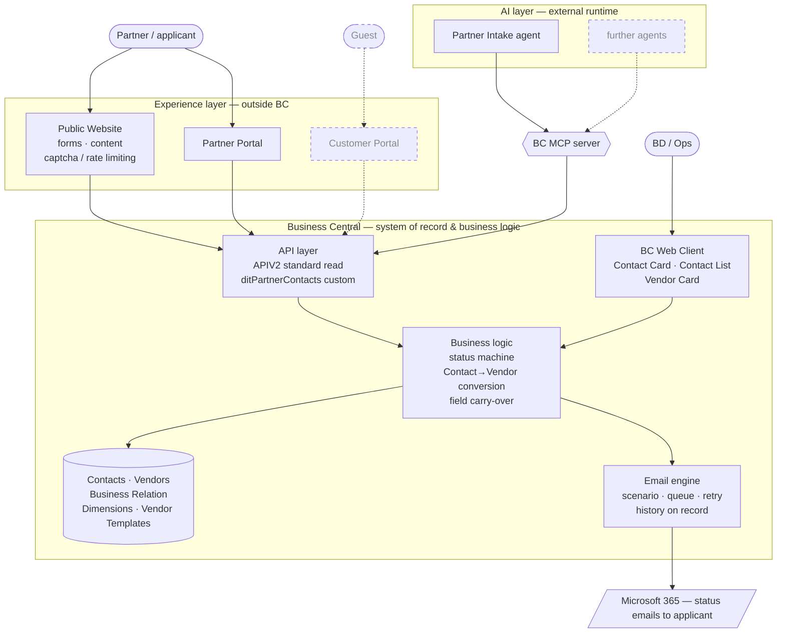

# Technical Design — DIT Enterprise Platform

> Process-first design. Every process below gets classified (external / internal), then designed: how it's automated, which system it lives in, whether PTE objects are required, what's exposed via API/MCP, which AI agents touch it. Decisions are numbered (D-xx) so specs can cite them. Discovery material lives in `research/process-discovery.md`.

## Table of Contents

- [How to read this](#how-to-read-this)
- [Process Inventory](#process-inventory)
- **A. Supply**
  - [P-01 Partner acquisition & onboarding](#p-01-partner-acquisition--onboarding)
  - [P-02 Partner certification & contracting](#p-02-partner-certification--contracting)
  - [P-03 Catalog & program management](#p-03-catalog--program-management)
  - [P-04 Capacity & availability management](#p-04-capacity--availability-management)
- **B. Demand**
  - [P-05 Marketing & attribution](#p-05-marketing--attribution)
  - [P-06 Guest intake & WBS assessment](#p-06-guest-intake--wbs-assessment)
  - [P-07 Matching & recommendation](#p-07-matching--recommendation)
  - [P-08 Sales pipeline & CRM](#p-08-sales-pipeline--crm)
- **C. Booking & Money**
  - [P-09 Reservation & booking](#p-09-reservation--booking)
  - [P-10 Guest payments — deposit, balance, refunds](#p-10-guest-payments--deposit-balance-refunds)
  - [P-11 Commission calculation & settlement](#p-11-commission-calculation--settlement)
  - [P-12 Partner payouts](#p-12-partner-payouts)
  - [P-13 Accounting & reporting](#p-13-accounting--reporting)
- **D. Fulfillment & Outcomes**
  - [P-14 Pre-trip fulfillment ops](#p-14-pre-trip-fulfillment-ops)
  - [P-15 On-trip servicing & check-ins](#p-15-on-trip-servicing--check-ins)
  - [P-16 Post-trip outcomes & follow-up](#p-16-post-trip-outcomes--follow-up)
  - [P-17 Repeat & retention](#p-17-repeat--retention)
- **E. Partner-facing**
  - [P-18 Partner dashboard & reporting](#p-18-partner-dashboard--reporting)
- **Cross-cutting (synthesized from processes)**
  - [X-1 Architecture overview](#x-1-architecture-overview)
  - [X-2 Entity map](#x-2-entity-map)
  - [X-3 API & MCP registry](#x-3-api--mcp-registry)
  - [X-4 Security & compliance](#x-4-security--compliance)
  - [X-5 Migration roadmap](#x-5-migration-roadmap)
  - [X-6 Decision register](#x-6-decision-register)

---

## How to read this

Each process section uses the same template:

| Field | Meaning |
|---|---|
| Type | External (guest/partner-facing) or Internal (back-office) |
| **Summary** | **A step-by-step flow table: each step, the system/page where it happens, the data created or changed, and whether it is standard BC, new PTE development, an agent, or outside BC. Normal BC terminology, no object IDs. This is the management/functional view; technical detail lives in the fields below.** |
| Trigger & actors | What starts it, who participates |
| Target flow | The designed process steps (not necessarily as-is) |
| System | System of record + where business logic executes |
| Automation | What runs without a human, and how |
| PTE | Custom BC objects required (tables, pages, codeunits) — or "standard BC" |
| API / MCP | What this process exposes or consumes |
| AI agents | Which agents participate and what they're allowed to do |
| Decisions | D-xx numbered decisions with one-line rationale |
| Open questions | What blocks completion |

Status legend in the inventory: 🟢 live in MVP · 🟡 partial/manual · ⚪ not built.

**Reference sources**

- **As-is platform:** live Supabase portal source in `../reamislands-platform` (Next.js; public site + panel (admin/partner/me) + API routes incl. `/api/intake`; 16 SQL migrations). Input for design, *not* a migrate-as-is source.
- **BC ground truth:** `/Users/Shared/BCApps` (a shared clone beside this repo, opened as the `BCApps` folder of `dreamislands.code-workspace`; not a submodule) — Microsoft's open-source repo, ~36.5k AL files. Contains **Base Application** (`src/Layers/W1/BaseApp`) plus country layers (`src/Layers/<CC>/BaseApp`), **System Application** (Email, Azure Function, Recurrence Schedule…), **Business Foundation** (No. Series, Audit Codes, Permissions), **APIV1/APIV2** apps (the standard API pages), native **Agent** apps (AgentDesignExperience, AgentSamples, SalesOrderAgent, PayablesAgent, ExpenseAgent), and W1 add-ons. All BC claims in this document should be checked here. *(The BC MCP server itself is not in this repo — it is a service-side component; verify separately.)*

---

## Process Inventory

| ID | Process | Type | Today | Target system |
|---|---|---|---|---|
| P-01 | Partner acquisition & onboarding | External | 🟡 manual, team-driven | BC Contact→Vendor · portal form · MCP intake agent |
| P-02 | Partner certification & contracting | Internal | 🟡 Notion checklist | TBD |
| P-03 | Catalog & program management | Internal | 🟢 Supabase, team-entered | TBD |
| P-04 | Capacity & availability management | Internal | ⚪ none (no availability check) | TBD |
| P-05 | Marketing & attribution | External | 🟢 GA4/Ads/Meta + di_attr | TBD |
| P-06 | Guest intake & WBS assessment | External | 🟢 WBS form live | TBD |
| P-07 | Matching & recommendation | External | 🟡 n8n prototype logic | TBD |
| P-08 | Sales pipeline & CRM | Internal | 🟡 Notion-era, manual | TBD |
| P-09 | Reservation & booking | External | 🟢 live, flawed (no availability) | TBD |
| P-10 | Guest payments — deposit, balance, refunds | External | 🟡 deposit only; balance undocumented | TBD |
| P-11 | Commission calculation & settlement | Internal | 🟢 commercial_terms + booking_financials | TBD |
| P-12 | Partner payouts | Internal | ⚪ undocumented | TBD |
| P-13 | Accounting & reporting | Internal | ⚪ outside platform | TBD |
| P-14 | Pre-trip fulfillment ops | Internal | 🟡 Notion ops board | TBD |
| P-15 | On-trip servicing & check-ins | External | ⚪ designed only | TBD |
| P-16 | Post-trip outcomes & follow-up | External | ⚪ designed only | TBD |
| P-17 | Repeat & retention | External | ⚪ designed only | TBD |
| P-18 | Partner dashboard & reporting | External | ⚪ not started | TBD |

---

# A. Supply

## P-01 Partner acquisition & onboarding

- **Type:** External

### Summary

| # | Step | Responsible | System / page | Data created or changed | Build |
|---|---|---|---|---|---|
| 1 | Property submits application | Partner (applicant) | Website — public partner form | Raw application | outside BC |
| 2 | Application normalized, deduped and filed | Partner Intake agent | BC MCP → Partner Contacts API | **Contact** (Company) + contact Person; partner fields; Status = *Prospect*; dedupe note | agent + PTE |
| 2a | *(alt.)* BD enters a prospect directly | BD | BC — Contact Card | Same as above, entered manually | standard |
| 3 | BD works the pipeline, reviews and decides | BD | BC — Contact List / Contact Card | Status → *In Review* → *Approved* / *Rejected* | standard + PTE field |
| 4 | Applicant notified at every status change | System (automatic) | BC — Email (M365 connector) | Email sent and logged on the Contact | PTE |
| 5 | Approved partner converted | BD / Ops (manual) | BC — Contact Card → *Create as Vendor* | **Vendor** created from the country **Vendor Template** (currency, payment terms, tax); Contact Business Relation link; partner fields copied; PARTNERTYPE default dimension | standard + PTE |
| 6 | Portal access granted | System (automatic) | Partner Portal (+ BC Vendor API) | Portal user linked to the Vendor | outside BC + PTE |
| 7 | Hand-off | — | → P-02 Certification & contracting | Vendor with Status = *Onboarding* | — |

- **Trigger & actors:** (a) Inbound — property applies via open form on the public website (no invite gate); (b) BD-driven — Mark/ops enter a prospect directly. Actors: partner applicant, BD/ops, Partner Intake agent.
- **Target flow:**
  1. Application arrives via open web form → portal backend (spam control — captcha/rate limiting — at the portal edge, not in BC). BD-sourced prospects are entered directly in BC.
  2. **Partner Intake agent** normalizes the submission and creates a **Contact (Company)** in BC via BC MCP with all required fields; contact person as linked Person contact. Before creating, agent runs a dedupe search against existing contacts/vendors and flags suspected duplicates in the record.
  3. BD works the prospect as a pipeline directly on Contacts: Partner Status = Prospect → In Review → Approved / Rejected (+ segments for campaigns).
  4. **Every status change fires an automated email** to the applicant (received / in review / approved + next steps / rejected).
  5. On approval: **manual conversion** via the standard Contact action → `Contact.CreateVendor()`, selecting the country **Vendor Template**. PTE subscriber on `OnAfterCreateVendor` copies partner fields to the Vendor. Vendor currency = partner's local currency (multi-country supply, one DIT legal entity in Singapore).
  6. Post-conversion: portal access provisioned (partner user ↔ Vendor link) → hand-off to P-02 (certification & contracting). Property/program data entry belongs to P-03.
- **System:** BC = system of record (Contact → Vendor), status machine, email chain. Portal = form UX only. Agent runtime external, entering through BC MCP.
- **Automation:** intake normalization + dedupe + Contact creation (agent); status-change email chain (event subscriber → System App Email module, see D-05); portal invite on vendor creation. Manual by design: approval decision, Contact→Vendor conversion.
- **PTE:**
  - Contact table ext: Partner Status (enum), **Partner Type Code (Code[20], TableRelation → `Dimension Value` where Dimension Code = `PARTNERTYPE`)**, Lead Source, Expected Monthly Capacity
  - Vendor table ext: partner fields copied on conversion, SLA Tier (used from P-02) — Partner Type is *not* a Vendor field, it becomes a Default Dimension (D-07)
  - Enums: Partner Status, SLA Tier
  - Setup data (not code): Dimension `PARTNERTYPE` + values HOTEL / CLINIC / COACH / EXPERIENCE
  - Codeunits: status-change → email chain; subscriber on **`Contact.OnAfterCreateVendor(Contact, Vendor)`** (verified, `Contact.Table.al:3739`) — copy fields, **write the `PARTNERTYPE` Default Dimension on the new Vendor**, raise portal-provisioning event
  - Custom API page `ditPartnerContacts` (see API/MCP — mandatory, not optional)
  - Enum extension on `Email Scenario` (8890, Extensible) — one scenario per partner-status email
  - Email body templates per status. **No custom staging table.**
- **API / MCP:** **Custom API page `ditPartnerContacts` (Contact) is required** — verified: all 147 `APIV2` pages, including page 30071 "APIV2 - Contacts", are declared `Extensible = false`, so PTE fields cannot be surfaced on the standard contacts API. The custom page exposes standard + PTE fields in one entity so the agent writes a complete record in a single call. Standard `APIV2 - Contacts` remains available read-side for generic consumers. Agent permission set: Contacts RW only, no Vendor write. Vendor read API for portal provisioning → detailed in P-18.
- **AI agents:** **Partner Intake agent** — parse free-form application, normalize to canonical fields, dedupe check, create Contact via MCP, log summary to contact notes. Not allowed: creating Vendors, setting status to Approved/Rejected (human-only).
- **Decisions:**
  - **D-01** Partner requests land as standard **Contacts (Company)** with PTE status/type fields — no staging table. Pipeline = status/segment on Contact. *Rationale: lean; standard CRM; standard conversion path already exists.*
  - **D-02** Contact → Vendor conversion is **manual** (standard `Contact.CreateVendor()`), human-approved; PTE subscriber on `OnAfterCreateVendor` carries fields over. The Contact↔Vendor link is maintained by the standard **Contact Business Relation** table (requires `Bus. Rel. Code for Vendors` in Marketing Setup) — **no custom link field**; standard `CheckForExistingRelationships` already blocks double conversion.
  - **D-03** Intake agent writes via BC MCP to **Contacts only**; financial master data (Vendor) is human-gated. *First instance of the system-wide agent write boundary: prospect/CRM data = agent-writable, financial master data = human-only.*
  - **D-04** One BC company (SG legal entity); partners multi-country; Vendor currency per partner. Implemented via **one Vendor Template per country/currency** (e.g. `PARTNER-TH`, `PARTNER-ID`, `PARTNER-SG`) carrying currency code, posting groups, payment terms and tax setup — `CreateVendor()` requires a matching template by Contact Type and prompts for selection, so conversion configures the vendor correctly with no custom code. *Base currency (SGD?) → confirm in P-13.*
  - **D-05** Status-change **email chain automated in BC** using the System Application **Email module** (verified in BCApps): `Email.Enqueue(Message, NotBefore)` for async/deferred sending with built-in retry (`Email Retry` table 8890) — no custom job queue needed; one **`Email Scenario` enum extension value per status** so the sending account is admin-configurable per scenario without code changes; `Email.AddRelation(Message, Database::Contact, SystemId, …)` so the whole chain is visible and auditable on the partner record. Portal access granted post-approval only.
  - **D-06** Inbound applications are **truly open**; spam/abuse control lives at the portal edge (captcha, rate limiting), not in BC.
  - **D-07** **Partner Type is a Dimension** (`PARTNERTYPE`: HOTEL / CLINIC / COACH / EXPERIENCE), not an enum field. On the **Vendor** it is a **Default Dimension** record (Table ID 23 — Vendor has Global Dimension 1/2 Code, fields 16/17, verified), so it flows automatically onto purchase documents, vendor ledger and G/L entries — partner-type P&L analysis with no custom reporting code.
    *Constraint found in source:* the **Contact table has no dimension support whatsoever** (zero dimension fields/references in `Contact.Table.al`). Therefore at prospect stage the Contact carries **`Partner Type Code` as a `Dimension Value` lookup** — one source of truth for the value list, no enum/dimension drift — and the `OnAfterCreateVendor` subscriber converts it into the Vendor's Default Dimension.
    *Rejected:* making Contact dimension-capable via PTE (feasible — `DefaultDimObjectNoWithGlobalDimsList` auto-discovers any table with `*Global Dimension*` Code[20] fields, plus the `OnAfterDefaultDimObjectNoList` integration event) — heavy plumbing with no financial payoff, since prospects generate no ledger entries.
    *Rejected:* carrying Partner Type via Vendor Templates — templates are already the country/currency axis (D-04); country × type would be a ~20-template matrix.
  - **D-08** Email transport = **standard Microsoft 365 connector** (`Email - Microsoft 365 Connector` app, shipped in BCApps W1). Combined with D-05's scenario indirection, the account per scenario stays admin-configurable.
- **Open questions:**
  - ~~Standard contacts API + PTE fields?~~ **Resolved** — `Extensible = false` on all APIV2 pages ⇒ custom API page required (D-03).
  - ~~Email connector?~~ **Resolved** — standard M365 connector (D-08).
  - ~~Does BC MCP expose custom API pages?~~ **Resolved — yes** (confirmed by Dmitry). Custom API pages are MCP-addressable; this unblocks the agent path here and for all later processes.
  - **Cross-cutting, park for P-13:** dimension slot allocation. BC gives 2 global + 6 shortcut dimensions (verified: `Shortcut Dimension 1–8 Code` in G/L Setup). DIT will want several analysis axes — Partner Type, Destination/Country, likely Cohort and Program Category. Decide which occupy the two *global* slots company-wide before any dimension is created.

## P-02 Partner certification & contracting

- **Type:** Internal

### Summary

| # | Step | Responsible | System / page | Data created or changed | Build |
|---|---|---|---|---|---|
| | _TBD_ | | | | |

- **Trigger & actors:**
- **Target flow:**
- **System:**
- **Automation:**
- **PTE:**
- **API / MCP:**
- **AI agents:**
- **Decisions:**
- **Open questions:**

## P-03 Catalog & program management

- **Type:** Internal

### Summary

| # | Step | Responsible | System / page | Data created or changed | Build |
|---|---|---|---|---|---|
| | _TBD_ | | | | |

- **Trigger & actors:**
- **Target flow:**
- **System:**
- **Automation:**
- **PTE:**
- **API / MCP:**
- **AI agents:**
- **Decisions:**
- **Open questions:**

## P-04 Capacity & availability management

- **Type:** Internal

### Summary

| # | Step | Responsible | System / page | Data created or changed | Build |
|---|---|---|---|---|---|
| | _TBD_ | | | | |

- **Trigger & actors:**
- **Target flow:**
- **System:**
- **Automation:**
- **PTE:**
- **API / MCP:**
- **AI agents:**
- **Decisions:**
- **Open questions:**

---

# B. Demand

## P-05 Marketing & attribution

- **Type:** External

### Summary

| # | Step | Responsible | System / page | Data created or changed | Build |
|---|---|---|---|---|---|
| | _TBD_ | | | | |

- **Trigger & actors:**
- **Target flow:**
- **System:**
- **Automation:**
- **PTE:**
- **API / MCP:**
- **AI agents:**
- **Decisions:**
- **Open questions:**

## P-06 Guest intake & WBS assessment

- **Type:** External

### Summary

| # | Step | Responsible | System / page | Data created or changed | Build |
|---|---|---|---|---|---|
| | _TBD_ | | | | |

- **Trigger & actors:**
- **Target flow:**
- **System:**
- **Automation:**
- **PTE:**
- **API / MCP:**
- **AI agents:**
- **Decisions:**
- **Open questions:**

## P-07 Matching & recommendation

- **Type:** External

### Summary

| # | Step | Responsible | System / page | Data created or changed | Build |
|---|---|---|---|---|---|
| | _TBD_ | | | | |

- **Trigger & actors:**
- **Target flow:**
- **System:**
- **Automation:**
- **PTE:**
- **API / MCP:**
- **AI agents:**
- **Decisions:**
- **Open questions:**

## P-08 Sales pipeline & CRM

- **Type:** Internal

### Summary

| # | Step | Responsible | System / page | Data created or changed | Build |
|---|---|---|---|---|---|
| | _TBD_ | | | | |

- **Trigger & actors:**
- **Target flow:**
- **System:**
- **Automation:**
- **PTE:**
- **API / MCP:**
- **AI agents:**
- **Decisions:**
- **Open questions:**

---

# C. Booking & Money

## P-09 Reservation & booking

- **Type:** External

### Summary

| # | Step | Responsible | System / page | Data created or changed | Build |
|---|---|---|---|---|---|
| | _TBD_ | | | | |

- **Trigger & actors:**
- **Target flow:**
- **System:**
- **Automation:**
- **PTE:**
- **API / MCP:**
- **AI agents:**
- **Decisions:**
- **Open questions:**

## P-10 Guest payments — deposit, balance, refunds

- **Type:** External

### Summary

| # | Step | Responsible | System / page | Data created or changed | Build |
|---|---|---|---|---|---|
| | _TBD_ | | | | |

- **Trigger & actors:**
- **Target flow:**
- **System:**
- **Automation:**
- **PTE:**
- **API / MCP:**
- **AI agents:**
- **Decisions:**
- **Open questions:** balance collection process undefined (deposit → rest: when, how, where?); currency policy (USD display / THB charge / multi-country)

## P-11 Commission calculation & settlement

- **Type:** Internal

### Summary

| # | Step | Responsible | System / page | Data created or changed | Build |
|---|---|---|---|---|---|
| | _TBD_ | | | | |

- **Trigger & actors:**
- **Target flow:**
- **System:**
- **Automation:**
- **PTE:**
- **API / MCP:**
- **AI agents:**
- **Decisions:**
- **Open questions:**

## P-12 Partner payouts

- **Type:** Internal

### Summary

| # | Step | Responsible | System / page | Data created or changed | Build |
|---|---|---|---|---|---|
| | _TBD_ | | | | |

- **Trigger & actors:**
- **Target flow:**
- **System:**
- **Automation:**
- **PTE:**
- **API / MCP:**
- **AI agents:**
- **Decisions:**
- **Open questions:** payout execution undefined (schedule, method, reconciliation — ask Mark)

## P-13 Accounting & reporting

- **Type:** Internal

### Summary

| # | Step | Responsible | System / page | Data created or changed | Build |
|---|---|---|---|---|---|
| | _TBD_ | | | | |

- **Trigger & actors:**
- **Target flow:**
- **System:**
- **Automation:**
- **PTE:**
- **API / MCP:**
- **AI agents:**
- **Decisions:**
- **Open questions:**

---

# D. Fulfillment & Outcomes

## P-14 Pre-trip fulfillment ops

- **Type:** Internal

### Summary

| # | Step | Responsible | System / page | Data created or changed | Build |
|---|---|---|---|---|---|
| | _TBD_ | | | | |

- **Trigger & actors:**
- **Target flow:**
- **System:**
- **Automation:**
- **PTE:**
- **API / MCP:**
- **AI agents:**
- **Decisions:**
- **Open questions:**

## P-15 On-trip servicing & check-ins

- **Type:** External

### Summary

| # | Step | Responsible | System / page | Data created or changed | Build |
|---|---|---|---|---|---|
| | _TBD_ | | | | |

- **Trigger & actors:**
- **Target flow:**
- **System:**
- **Automation:**
- **PTE:**
- **API / MCP:**
- **AI agents:**
- **Decisions:**
- **Open questions:**

## P-16 Post-trip outcomes & follow-up

- **Type:** External

### Summary

| # | Step | Responsible | System / page | Data created or changed | Build |
|---|---|---|---|---|---|
| | _TBD_ | | | | |

- **Trigger & actors:**
- **Target flow:**
- **System:**
- **Automation:**
- **PTE:**
- **API / MCP:**
- **AI agents:**
- **Decisions:**
- **Open questions:**

## P-17 Repeat & retention

- **Type:** External

### Summary

| # | Step | Responsible | System / page | Data created or changed | Build |
|---|---|---|---|---|---|
| | _TBD_ | | | | |

- **Trigger & actors:**
- **Target flow:**
- **System:**
- **Automation:**
- **PTE:**
- **API / MCP:**
- **AI agents:**
- **Decisions:**
- **Open questions:**

---

# E. Partner-facing

## P-18 Partner dashboard & reporting

- **Type:** External

### Summary

| # | Step | Responsible | System / page | Data created or changed | Build |
|---|---|---|---|---|---|
| | _TBD_ | | | | |

- **Trigger & actors:**
- **Target flow:**
- **System:**
- **Automation:**
- **PTE:**
- **API / MCP:**
- **AI agents:**
- **Decisions:**
- **Open questions:**

---

# Cross-cutting (synthesized from processes)

> These sections are **registries, not designs** — every row is produced by a process section and links back to it. They are appended to as each P-xx is completed, and reviewed as a whole once all processes are done. Currently populated from: [P-01](#p-01-partner-acquisition--onboarding).

## X-1 Architecture overview

Solid lines = designed and agreed. Dashed = anticipated, not yet designed.

Component inventory — role, and the processes that put it there.

| Component | Role | Used by |
|---|---|---|
| **Business Central** | System of record + business logic | [P-01](#p-01-partner-acquisition--onboarding) |
| **BC MCP server** | Agent access path into BC (custom API pages are MCP-addressable) | [P-01](#p-01-partner-acquisition--onboarding) |
| **Agent runtime** (external) | Hosts AI agents; reaches BC only via MCP | [P-01](#p-01-partner-acquisition--onboarding) |
| **Partner Portal** | Partner-facing UX; no business logic of its own | [P-01](#p-01-partner-acquisition--onboarding) |
| **Public Website** | Public forms and content; spam/abuse control at the edge | [P-01](#p-01-partner-acquisition--onboarding) |
| **M365 (email)** | Email transport behind BC's email engine | [P-01](#p-01-partner-acquisition--onboarding) |
| Customer Portal | — | _pending P-06/P-16/P-17_ |
| Booking Engine | — | _pending P-09_ |
| Payment layer | — | _pending P-10_ |
| Analytics | — | _pending P-05/P-13_ |

## X-2 Entity map

Every entity touched, its kind, and where it was decided.

| Entity | Kind | Source | Notes |
|---|---|---|---|
| **Contact** | standard + table extension | [P-01](#p-01-partner-acquisition--onboarding) · D-01 | Partner Status, Partner Type Code, Lead Source, Expected Monthly Capacity |
| **Vendor** | standard + table extension | [P-01](#p-01-partner-acquisition--onboarding) · D-02 | SLA Tier + partner fields copied on conversion |
| **Contact Business Relation** | standard, used as-is | [P-01](#p-01-partner-acquisition--onboarding) · D-02 | Contact↔Vendor link + duplicate-conversion guard |
| **Vendor Template** | standard, setup data | [P-01](#p-01-partner-acquisition--onboarding) · D-04 | One per partner country — currency, posting groups, payment terms, tax |
| **Dimension `PARTNERTYPE`** | setup data | [P-01](#p-01-partner-acquisition--onboarding) · D-07 | Default Dimension on Vendor; Contact holds a Dimension Value lookup |
| **Email Scenario** | standard enum, extended | [P-01](#p-01-partner-acquisition--onboarding) · D-05 | One value per partner status |

⚠ **Open, cross-cutting:** dimension slot allocation — 2 global + 6 shortcut available. Candidates so far: Partner Type ([P-01](#p-01-partner-acquisition--onboarding)), plus likely Destination/Country, Cohort, Program Category. Decide before creating further dimensions → [P-13](#p-13-accounting--reporting).

## X-3 API & MCP registry

| API | Entity | Consumers | Kind | Source |
|---|---|---|---|---|
| **`ditPartnerContacts`** | Contact (standard + PTE fields) | Partner Intake agent (via MCP); Partner Portal | custom API page — **required**, standard APIV2 pages are `Extensible = false` | [P-01](#p-01-partner-acquisition--onboarding) · D-03 |
| `APIV2 - Contacts` | Contact (standard fields) | generic read consumers | standard, read-side | [P-01](#p-01-partner-acquisition--onboarding) |
| Vendor read | Vendor | Partner Portal provisioning | TBD — detail in [P-18](#p-18-partner-dashboard--reporting) | [P-01](#p-01-partner-acquisition--onboarding) |

## X-4 Security & compliance

| Topic | Rule | Source |
|---|---|---|
| **Agent write boundary** | Agents may write prospect/CRM data; **financial master data is human-gated**. Applies system-wide — re-assert in every process with an agent. | [P-01](#p-01-partner-acquisition--onboarding) · D-03 |
| **Human-only decisions** | Approve/reject a partner; Contact→Vendor conversion. | [P-01](#p-01-partner-acquisition--onboarding) · D-02 |
| **Agent permissions** | Dedicated permission set per agent, least-privilege (intake agent: Contacts RW, no Vendor). | [P-01](#p-01-partner-acquisition--onboarding) |
| **Public surface** | Open inbound forms; captcha/rate limiting at the portal edge, never in BC. | [P-01](#p-01-partner-acquisition--onboarding) · D-06 |
| Partner data isolation | — | _pending [P-18](#p-18-partner-dashboard--reporting)_ |
| Medical/wellness data, GDPR, PDPA (TH+SG) | — | _pending [P-06](#p-06-guest-intake--wbs-assessment), [P-15](#p-15-on-trip-servicing--check-ins), [P-16](#p-16-post-trip-outcomes--follow-up)_ |
| Audit logging | — | _pending [P-13](#p-13-accounting--reporting)_ |

## X-5 Migration roadmap

Starting frame from the scope doc (6 phases); processes are assigned as their target design is agreed.

| Phase | Content | Processes |
|---|---|---|
| 1 | Read-only integrations | _TBD_ |
| 2 | Bookings | _pending [P-09](#p-09-reservation--booking)_ |
| 3 | Finance | _pending [P-10](#p-10-guest-payments--deposit-balance-refunds), [P-11](#p-11-commission-calculation--settlement), [P-12](#p-12-partner-payouts), [P-13](#p-13-accounting--reporting)_ |
| 4 | Partner operations | [P-01](#p-01-partner-acquisition--onboarding) *(greenfield — no migration, MVP has no partner onboarding)*, _pending [P-02](#p-02-partner-certification--contracting), [P-18](#p-18-partner-dashboard--reporting)_ |
| 5 | Analytics | _pending [P-05](#p-05-marketing--attribution)_ |
| 6 | Full migration | _TBD_ |

## X-6 Decision register

| ID | Decision | Source |
|---|---|---|
| **D-01** | Partner requests land as standard **Contacts** with PTE status/type fields — no staging table | [P-01](#p-01-partner-acquisition--onboarding) |
| **D-02** | Contact → Vendor conversion is **manual**; link via standard Contact Business Relation | [P-01](#p-01-partner-acquisition--onboarding) |
| **D-03** | Agents write **Contacts only**; financial master data is human-gated *(system-wide principle)* | [P-01](#p-01-partner-acquisition--onboarding) |
| **D-04** | **One BC company** (SG legal entity); multi-country vendors via one **Vendor Template per country** | [P-01](#p-01-partner-acquisition--onboarding) |
| **D-05** | Status-change **email chain** on BC's email engine — scenario per status, deferred send, auto-retry, history on the record | [P-01](#p-01-partner-acquisition--onboarding) |
| **D-06** | Inbound applications **truly open**; abuse control at the portal edge | [P-01](#p-01-partner-acquisition--onboarding) |
| **D-07** | **Partner Type is a Dimension**, not an enum — Default Dimension on Vendor, Dimension Value lookup on Contact | [P-01](#p-01-partner-acquisition--onboarding) |
| **D-08** | Email transport = standard **Microsoft 365 connector** | [P-01](#p-01-partner-acquisition--onboarding) |
